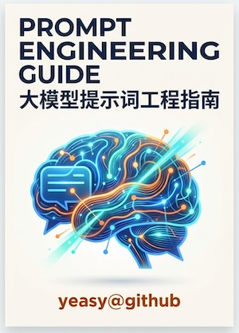

# 大模型提示词工程指南

从写出第一条结构化提示词，到构建可评测、可维护的 AI 应用。

**[在 GitBook 阅读第一章 · 提示词工程概述](https://yeasy.gitbook.io/prompt_engineering_guide/di-yi-bu-fen-ji-chu-pian/01_introduction)**

[全书目录（GitHub）](https://github.com/yeasy/prompt_engineering_guide/blob/main/SUMMARY.md) · [正式 PDF（发布页）](https://github.com/yeasy/prompt_engineering_guide/releases/latest)



## 关于本书

大语言模型（Large Language Models, LLMs）已成为推动各行业变革的核心力量。无论是 [OpenAI 的 GPT 系列](https://chatgpt.com/)、[Anthropic 的 Claude](https://anthropic.com/claude)、[Google 的 Gemini](https://gemini.google.com/)，还是众多开源模型，这些 AI 系统正在改变人们的工作方式、创作流程和解决问题的思路。

然而，仅有访问权限并不足以发挥这些模型的全部潜力。**提示词工程**是一门新兴学科，它连接人类意图与 AI 能力。一个精心设计的提示词可以将模糊的想法转化为精确的输出，将复杂的任务分解为可执行的步骤，将潜在的错误降到最低。

本书系统介绍提示词工程的核心概念、技术原理、实用技巧和高级策略，内容从基础的提示词结构设计，到高级的思维链推理、多模态提示、智能体（Agent）系统构建，再到企业级的提示词运维最佳实践，引导读者逐步掌握这门技能。

## 从哪里开始

- **先写一条结构化提示词** · 参照[提示词的核心组成要素](https://yeasy.gitbook.io/prompt_engineering_guide/di-yi-bu-fen-ji-chu-pian/03_prompt_structure/3.1_core_elements)，把“总结这份会议纪要”改成一条提取待办事项的提示词。指定输出“事项、负责人、截止日期”三列表格，缺失的信息填“未注明”。用同一份纪要运行两版提示词，检查有无遗漏或编造。
- **系统学习提示词工程** · 从[第一章](https://yeasy.gitbook.io/prompt_engineering_guide/di-yi-bu-fen-ji-chu-pian/01_introduction)开始，读完第 1–4 章掌握模型基础、提示词结构和迭代方法，再按下方的全书结构继续阅读。
- **把提示词用到生产系统** · 从[附录 I · 生产落地脊柱](appendix/i_production_spine.md)开始，先明确输入、输出和失败处理，再建立评测用例。根据任务需要，按附录的验收标准逐步扩展到上下文、确定性工作流、单智能体和多智能体。

<details>

<summary>按方向选读</summary>

- **AI 初学者** · 读第 1–5 章，练习提示词结构、指令设计和少样本示例。
- **开发与数据实践** · 读第 1–3 章和第 6–10 章，学习推理策略、任务分解、工具调用、检索增强和多模态提示。需要测试和评估时可查阅[第 12 章](https://yeasy.gitbook.io/prompt_engineering_guide/di-si-bu-fen-jin-jie-yu-zhan-wang/12_automated_pe)。
- **内容创作与知识工作** · 先读第 1–3 章，再读[第 10 章](https://yeasy.gitbook.io/prompt_engineering_guide/di-san-bu-fen-gao-ji-ying-yong-pian/10_multimodal)的多模态提示和[第 14 章](https://yeasy.gitbook.io/prompt_engineering_guide/di-si-bu-fen-jin-jie-yu-zhan-wang/14_future)的行业案例。
- **产品与企业应用** · 先读第 1–3 章，再从[第 11 章](https://yeasy.gitbook.io/prompt_engineering_guide/di-san-bu-fen-gao-ji-ying-yong-pian/11_safety_reliability)读到第 13 章，了解安全治理、提示词运维和跨平台适配。

</details>

## 全书结构

- **基础篇（第 1–4 章）** · 了解大语言模型如何处理提示词，练习设计指令、组织上下文、约束输出和迭代测试。从[第一章 · 提示词工程概述](https://yeasy.gitbook.io/prompt_engineering_guide/di-yi-bu-fen-ji-chu-pian/01_introduction)开始。
- **核心技术篇（第 5–7 章）** · 学习少样本提示、思维链与推理模型、任务分解和提示词链。从[第五章 · 少样本学习与示例驱动](https://yeasy.gitbook.io/prompt_engineering_guide/di-er-bu-fen-he-xin-ji-shu-pian/05_few_shot)开始。
- **高级应用篇（第 8–11 章）** · 将提示词用于工具调用、智能体、检索增强生成和多模态任务，处理安全与可靠性问题。从[第八章 · ReAct 与工具使用](https://yeasy.gitbook.io/prompt_engineering_guide/di-san-bu-fen-gao-ji-ying-yong-pian/08_react_tools)开始。
- **进阶与展望（第 12–14 章）** · 学习自动化优化、评估、提示词运维与跨平台适配，了解上下文工程和行业案例。从[第十二章 · 自动化提示词工程](https://yeasy.gitbook.io/prompt_engineering_guide/di-si-bu-fen-jin-jie-yu-zhan-wang/12_automated_pe)开始。

各章末尾设有小结。附录收录[常用提示词模板](https://yeasy.gitbook.io/prompt_engineering_guide/fu-lu/a_templates)、技术决策树、排错指南和[资源、工具与参考文献](appendix/c_resources.md)。

## 延伸阅读

- [《零基础学 AI》](https://yeasy.gitbook.io/ai_beginner_guide/) · 了解 AI 基本概念和日常用法，适合作为前置阅读。
- [《大模型上下文工程权威指南》](https://yeasy.gitbook.io/context_engineering_guide/) · 学习如何为模型组织检索结果、历史信息和其他任务上下文。
- [《大模型安全权威指南》](https://yeasy.gitbook.io/ai_security_guide/) · 深入学习提示词注入防御与安全设计。

<details>

<summary>更多系列图书</summary>

- [《Claude 技术指南》](https://yeasy.gitbook.io/claude_guide/) · 在 Claude 平台上实践提示词技术。
- [《智能体 AI 权威指南》](https://yeasy.gitbook.io/agentic_ai_guide/) · 学习智能体系统设计与协作。
- [《OpenClaw 从入门到精通》](https://yeasy.gitbook.io/openclaw_guide/) · 在开源智能体框架中实践。
- [《大模型原理与架构》](https://yeasy.gitbook.io/llm_internals/) · 深入理解大语言模型的训练、架构与推理。
- [《智能体 Harness 工程指南》](https://yeasy.gitbook.io/harness_engineering_guide/) · 学习智能体运行环境与输出治理。

</details>

## 反馈与贡献

欢迎在 [GitHub Issues](https://github.com/yeasy/prompt_engineering_guide/issues) 报告勘误或提出建议，也可以[提交 Pull Request](https://github.com/yeasy/prompt_engineering_guide/pulls)，补充实践案例和可复用模板。

<details>

<summary>本地开发与预览</summary>

安装 [mdPress](https://github.com/yeasy/mdpress) 后，在仓库根目录启动本地预览，再打开 `http://localhost:9000`。

```bash
brew tap yeasy/tap
brew install --cask mdpress
mdpress serve
```

[默认分支 PDF 预览版](https://github.com/yeasy/prompt_engineering_guide/releases/download/preview-pdf/prompt_engineering_guide.pdf)随主线更新，正式版本以发布页为准。

</details>

## 许可证

本书采用 [CC BY-NC-SA 4.0](https://creativecommons.org/licenses/by-nc-sa/4.0/) 授权。
